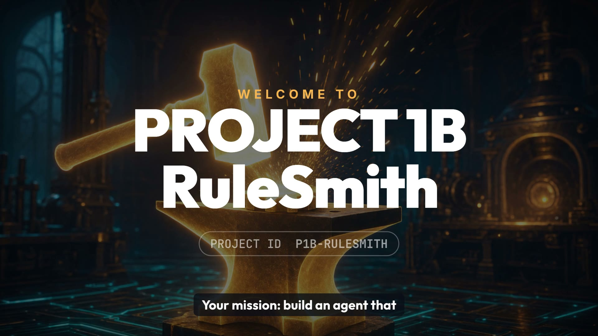
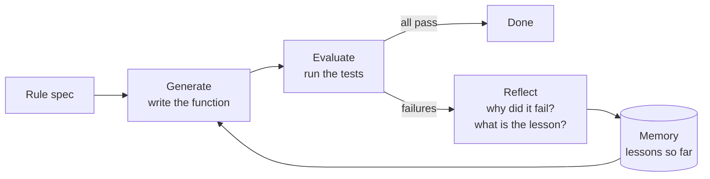

<div align="center">

# RuleSmith

### Project 1B &nbsp;·&nbsp; `P1B-RULESMITH`

**Build an agent that learns from its own mistakes, and prove it with numbers.**


[Problem Statement](PROBLEM_STATEMENT.md) &nbsp;|&nbsp; [Learning Path](docs/LEARNING_PATH.md) &nbsp;|&nbsp; [What to Submit](docs/SUBMISSION.md) &nbsp;|&nbsp; [Walkthrough Video](https://fnusatvik07.github.io/p1b-rulesmith/video/)

</div>

<br>

## Watch the walkthrough first

<div align="center">

<a href="https://fnusatvik07.github.io/p1b-rulesmith/video/">
  
</a>

**[Play the video in your browser](https://fnusatvik07.github.io/p1b-rulesmith/video/)** &nbsp;(3 minutes) &nbsp;·&nbsp; [Download it](https://github.com/fnusatvik07/p1b-rulesmith/releases/download/v1.0/P1B-RULESMITH_walkthrough.mp4)

</div>

<br>

## The story in 30 seconds

Every bank runs on small business rules. *Waive the foreign fee for Voyager cards, but not at the ATM. Wires after 5 PM New York time go out tomorrow. Never charge more than three overdraft fees in a day.*

Product writes these rules in plain English. Engineers turn them into code. And the bugs hide in the edges: a rounding rule, a time zone, a "day 30 still counts".

An LLM can write this code in seconds. It also gets the edges wrong, confidently. A cheap model, asked once, gets roughly **one rule in three** wrong.

**Your job: build RuleSmith, an agent that writes the code, runs the tests, works out *why* it failed, remembers the lesson, and tries again. Then show how much better it is than asking once.**

<br>

## The pattern: Reflexion



Plain **reflection** asks an LLM to critique its own answer. **Reflexion** grounds that critique in something real (here: test results), writes the lesson down, and carries the lessons into every next attempt. That is the difference you will build and measure.

<br>

## What is inside this repo

| Folder | What you get |
|:--|:--|
| [`tasks/`](tasks) | **20 business rules** (`spec.md`, a function stub, 3 visible tests each). Fees, Reg E deadlines, card masking, IBANs, time zones, interest, rewards. |
| [`harness/`](harness) | The **test runner** your agent calls (`run_tests`) and the **scorer** (`score.py`). Runs code in a separate process with a time limit. |
| [`eval/check/`](eval/check) | **Check tests** for your own scoring. Your agent must never see these. |
| [`starter/`](starter) | A working **one-shot baseline** and a **skeleton Reflexion graph** in LangGraph. |

The mentors also hold a **private test set** for every task. Your final score is on that.

<br>

## Get started in 5 minutes

```bash
git clone https://github.com/fnusatvik07/p1b-rulesmith.git
cd p1b-rulesmith
python -m venv .venv && source .venv/bin/activate
pip install openai langgraph langchain-openai
export OPENAI_API_KEY=...

# 1. look at one task
cat tasks/RS-01_foreign_transaction_fee/spec.md

# 2. run the one-shot baseline (one LLM call per task)
python starter/oneshot.py

# 3. score it on the check tests
python harness/score.py runs/oneshot --suite check
```

Then open [`starter/reflexion_graph.py`](starter/reflexion_graph.py) and fill in the TODOs.

<br>

## What you submit

- [ ] Code repository with a README that runs end to end
- [ ] `runs/oneshot/` and `runs/reflexion/`: one solution file per task
- [ ] `submission/REPORT.md`: before vs after, and 5 lessons your agent learned
- [ ] `submission/traces/`: the full attempt log for 3 tasks
- [ ] Demo video (5 minutes)

Due **Sunday 6 December 2026**. Details in [What to Submit](docs/SUBMISSION.md).
